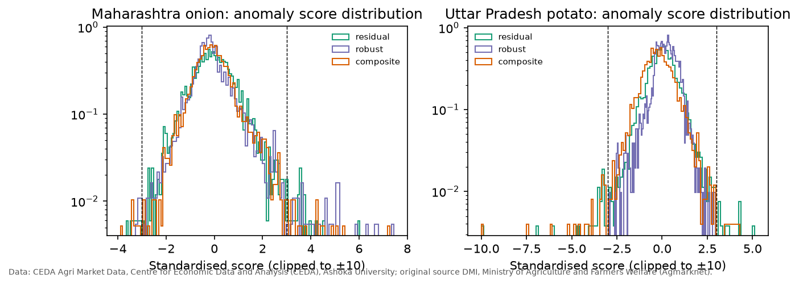
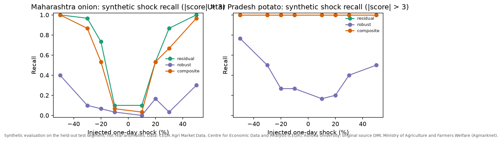
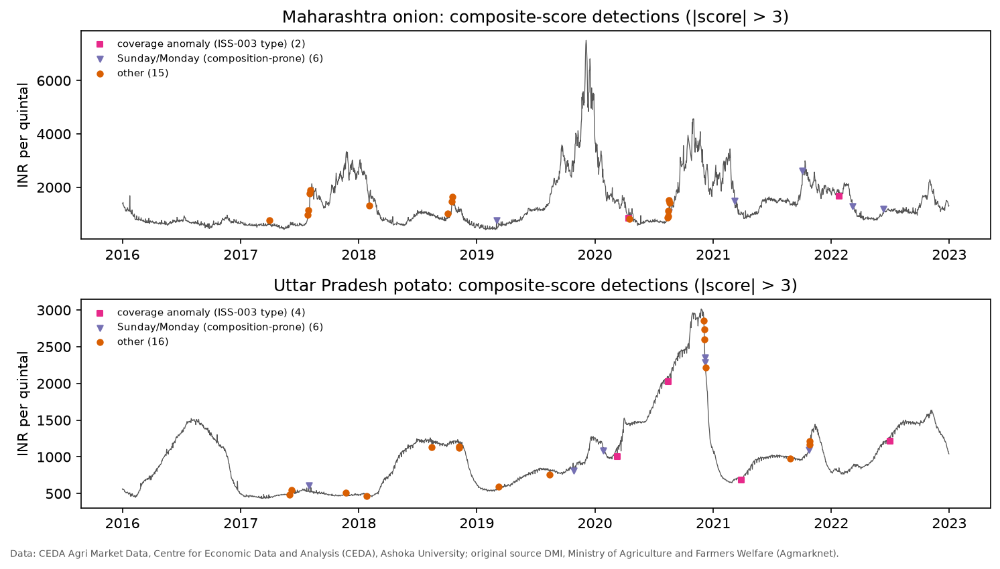
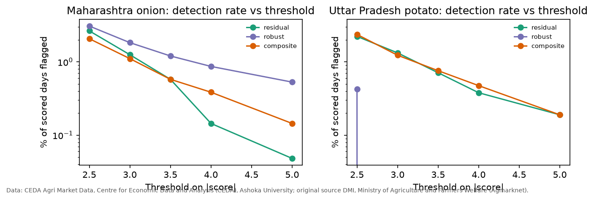

# CropCast — Market-Relative Anomaly Screening (M-6)

**Protocol:** `docs/anomaly_protocol.md` v1.0 (fixed before any score was computed) · **Run:** `reports/runs/anomaly-20261023T190355Z-a927040a/` · **Dataset:** v1
**Framing:** exploratory **screening**, not a validated detector. There is no independent ground truth, so no detection accuracy is claimed.
Tables are generated from the saved results (`python -m src.reporting.report_tables --report reports/anomaly_analysis.md`). Every score, detection and metric was recomputed independently by `python -m src.reporting.verify_anomaly --full`.

Data credit: CEDA Agri Market Data, Centre for Economic Data and Analysis (CEDA), Ashoka University; original source DMI/Agmarknet.

## 1. Method (summary)

**Definition.** A market day is anomalous when its state-level modal price deviates unusually from what the same market's own prior history predicts. Peer markets are not available (DEC-017).

**Scores.** All three are causal (they use only past data) and standardised again with past data only:
- **Residual score:** the z-score of one-step seasonal-ARIMA log residuals against the previous 30 residuals.
- **Robust score:** the weekday-adjusted deviation from the trailing 28-day median, scaled by the MAD.
- **Composite:** the 0.5/0.5 sum of the two.

**Rule and window.** A day is flagged when |score| > 3. Scores start after burn-in, on 2017-03-29 (onion) and 2017-03-22 (potato), covering 2,077 and 2,111 scored days.

## 2. Real-data screening (Req 6.5 ablation)

**Table A1.** Detections at |score| > 3, classified by data-quality context. Sun/Mon = composition-prone Sunday or Monday; Coverage = arrivals below 10% of the median (ISS-003 type).

<!-- BEGIN TABLE:anomaly_classes -->
| Series | Score | Scored days | Detections | Sun/Mon | Coverage | Other |
|---|---|---|---|---|---|---|
| Onion | Residual | 2077 | 26 (1.25%) | 9 | 1 | 16 |
| Onion | Robust | 2077 | 38 (1.83%) | 9 | 1 | 28 |
| Onion | Composite | 2077 | 23 (1.11%) | 6 | 2 | 15 |
| Potato | Residual | 2111 | 28 (1.33%) | 10 | 5 | 13 |
| Potato | Robust | 2111 | 0 (0.00%) | 0 | 0 | 0 |
| Potato | Composite | 2111 | 26 (1.23%) | 6 | 4 | 16 |
<!-- END TABLE:anomaly_classes -->

**Classes.**
- *Coverage anomaly:* arrivals below 10% of the median (ISS-003 type).
- *Sunday/Monday:* composition-prone days (EDA §3).
- *Other:* candidate market events.
- No detection fell on an ISS-002 band-violation day: almost all of that regime precedes the scored window.

**Findings (verified counts).**
- **Data-quality context.** 26–54% of detections, depending on series and score, are coverage anomalies or fall on composition-prone Sundays and Mondays.
- **Sensitivity to the threshold.** It is substantial (`anomaly_threshold_sensitivity.csv`). For example, residual-score detections for onion are 55 at 2.5, 26 at 3 and 3 at 4.
- **Potato robust score.** It made **zero detections** at |score| > 3, and 9 at 2.5. The reason is a weakness in the protocol's design, documented rather than altered after the fact:
  - The trailing-median deviation absorbs potato's smooth trends: the raw score exceeds |3| on 16% of days.
  - The second, non-robust standardisation (expanding mean and SD) is inflated by the extreme values of the November–December 2016 price collapse. Every later score is compressed below 3 (maximum 2.94).
  - Its precision is therefore **undefined (shown as —/NaN)**, not zero.

## 3. Agreement with ICTD-IITD weak labels (Req 6.6; not ground truth)

**Table A2.** Agreement with ICTD windows (any of the three rule flags set to "Anomaly"; mandi-level; same Agmarknet source). Label rate = share of evaluated days inside a labelled window; Null precision = median precision under 1,000 circular shifts of the detection sequence; Rand. p = randomisation p-value.

<!-- BEGIN TABLE:anomaly_weak -->
| Series | Score | Days | Label rate | Precision | Recall | F1 | Null precision | Rand. p |
|---|---|---|---|---|---|---|---|---|
| Onion | Residual | 1484 | 0.586 | 0.579 | 0.013 | 0.025 | 0.579 | 0.613 |
| Onion | Robust | 1484 | 0.586 | 0.200 | 0.008 | 0.015 | 0.629 | 0.900 |
| Onion | Composite | 1484 | 0.586 | 0.316 | 0.007 | 0.014 | 0.632 | 0.918 |
| Potato | Residual | 1742 | 0.716 | 0.741 | 0.016 | 0.031 | 0.704 | 0.465 |
| Potato | Robust | 1742 | 0.716 | — | 0.000 | 0.000 | — | — |
| Potato | Composite | 1742 | 0.716 | 0.680 | 0.014 | 0.027 | 0.720 | 0.686 |
<!-- END TABLE:anomaly_weak -->

**Interpretation.** The weak labels are **uninformative for evaluating a state-level screen**:
- ICTD "anomaly" windows cover **59% (onion) and 72% (potato)** of evaluated days.
- No method's precision exceeds the circular-shift baseline (randomisation p = 0.46–0.92).
- Recall is 0–1.6%.

These numbers neither support nor refute the screen. Weak-label agreement is **not** evidence of real-world detection accuracy.

## 4. Synthetic shocks (Req 6.7; synthetic, reported separately)

**Design.**
- One-day multiplicative shocks were injected into the held-out test segment (Aug 2021 – Dec 2022).
- Each run had six shocks at least 60 market days apart, with 5 seeded repeats for each of 8 magnitudes: 40 runs × 6 shocks per series.
- Residual-model parameters were frozen at the start of the segment.
- False-positive rates are computed on clean days, excluding the 7 days after each shock.

**Table A3.** Mean shock recall (share of injected shock days flagged) and mean false-positive rate.

<!-- BEGIN TABLE:anomaly_shocks -->
| Shock | Onion Res | Onion Rob | Onion Com | Potato Res | Potato Rob | Potato Com |
|---|---|---|---|---|---|---|
| -50% | 1.00 | 0.40 | 1.00 | 1.00 | 0.77 | 1.00 |
| -30% | 0.97 | 0.10 | 0.87 | 1.00 | 0.50 | 1.00 |
| -20% | 0.73 | 0.07 | 0.53 | 1.00 | 0.27 | 1.00 |
| -10% | 0.10 | 0.03 | 0.07 | 1.00 | 0.27 | 1.00 |
| +10% | 0.10 | 0.00 | 0.03 | 1.00 | 0.17 | 1.00 |
| +20% | 0.53 | 0.17 | 0.53 | 1.00 | 0.20 | 1.00 |
| +30% | 0.87 | 0.03 | 0.67 | 1.00 | 0.40 | 1.00 |
| +50% | 1.00 | 0.30 | 0.97 | 1.00 | 0.50 | 1.00 |
| FPR (clean days) | 0.98% | 0.48% | 0.51% | 0.22% | 0.01% | 0.45% |
<!-- END TABLE:anomaly_shocks -->

**Findings.**
- **Detectable shock size scales with volatility.** For potato (daily return SD 0.023), the residual and composite scores flag every shock from ±10%. For onion (SD 0.078), recall is at most 0.10 at ±10%, 0.53–0.97 at ±20–30%, and 0.97–1.00 at ±50% for the residual and composite scores.
- **Ablation.** The residual score has the highest recall. The robust score has low recall: 0–0.40 for onion and 0.17–0.77 for potato, consistent with its compression in §2.
- **False positives.** Rates are low (about 0.005–1% of clean days), so the score can be trusted most for large isolated spikes.

These are **controlled sensitivity tests on isolated one-day spikes only**. They do not measure detection of gradual or collective anomalies.

## 5. SARIMA convergence (Phase 1 verification)

**What happened.** The run recorded **5** SARIMA `ConvergenceWarning`s (counted, not suppressed). `python -m src.reporting.diagnose_sarima_convergence` replays the exact refit schedule and locates each one (`anomaly_sarima_convergence.csv`, `anomaly_sarima_convergence_impact.json`):
- All 5 are in the **potato residual walk-forward**, of 85 refits. The fits are at 2018-01-12 and 2020-02-07 (governing training targets), 2021-04-02 and 2021-04-30 (validation targets), and 2022-01-07 (test targets, 2022-01-08 to 2022-02-04).
- All 84 onion refits converged, and so did both frozen shock-evaluation fits (one per series, shared by all 40 shock runs).
- Each failure is a warm-started L-BFGS run that stopped after 1–2 iterations with `warnflag = 2` (abnormal line-search termination). A larger iteration budget from the same warm start stops at the identical point.

**Cold-start comparison.** Refitting each of those origins from statsmodels' default start values converges in 59–92 iterations:
- At three origins the original warm fit has a *higher* likelihood than the cold optimum (by 0.17–2.31 log-likelihood units).
- At two (2021-04-30 and 2022-01-07) it is slightly lower (by 0.16 and 0.43), so those two fits are not the best optimum found.

**Impact.** Substituting the converged cold-start parameters in each affected 28-day segment:
- changes the one-step log residuals by at most **0.0042** (about 0.4% of price);
- changes **no detection** at |score| > 3 for any method, on any day.

**Conclusion.** The affected residuals, scores and detections are **usable**. The non-convergence is recorded as a limitation, not hidden. Results were not rerun or replaced.

## 6. Figures

## 7. Limitations

- **No peer markets (DEC-017).** "Market-relative" means relative to the market's own history, and peer divergence, the charter's other signal, is untested.
- **No ground truth.** The ICTD labels are endogenous, mandi-level and too dense to discriminate.
- **Scoring window.** It starts in March 2017, so the ISS-002 regime (2016 – April 2017) is almost entirely outside it.
- **Robust-score design.** The protocol's robust score is trend-contaminated and non-robustly standardised (§2). A detrended score with robust standardisation is future work; it was not tried here, to avoid tuning after results.
- **Weekday composition.** Weekday adjustment reduces but does not remove composition-driven detections.
