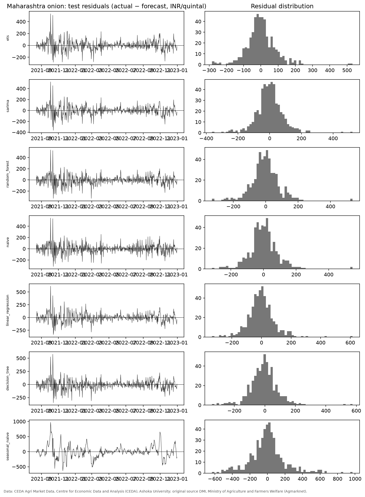
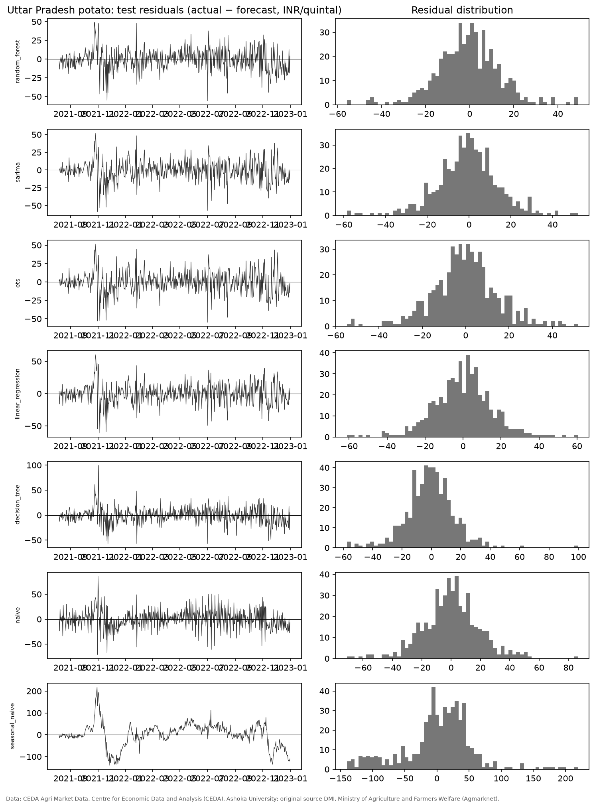
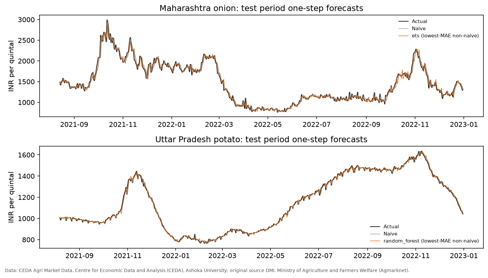

# CropCast — Forecasting Experiment Results (M-5)

**Protocol:** `docs/forecasting_protocol.md` v1.1 (fixed before any fit) · **Dataset:** v1 · **Runs:** `reports/runs/` (see `docs/experiment_log.md`)
**Tables below are generated from the saved results** by `python -m src.reporting.report_tables --report reports/experiment_results.md`, and are checked by `python -m src.verify`.

Data credit: CEDA Agri Market Data, Centre for Economic Data and Analysis (CEDA), Ashoka University; original source DMI/Agmarknet.

## 1. Ranked test results (Req 5.9)

Test period: onion 2021-08-14 – 2022-12-31 (505 one-step forecasts); potato 2021-08-07 – 2022-12-31 (512). Every test step refits on all data before its origin.

How to read the table:
- Rows are ranked by MAE within each series, in INR per quintal.
- MASE is scaled by the in-sample naive MAE on the training period.
- **DM** is the Diebold–Mariano statistic with the Harvey–Leybourne–Newbold correction (absolute-error loss) against naive; a negative value means lower loss than naive.
- **BH p** is the Benjamini–Hochberg-adjusted p-value across all 12 comparisons.
- MAPE is stable: the lowest test actual value is 759.5 INR/quintal (onion) and 763.4 (potato).

**Table 1.** Test-set comparison with the naive baseline. Δ MAE is relative to naive. Verdict: Better = lower MAE and BH p < 0.05; Worse = higher MAE and BH p < 0.05; n.s. = no significant difference.

<!-- BEGIN TABLE:forecast_metrics -->
| Series | Model | MAE | RMSE | MAPE % | MASE | Δ MAE | DM | BH p | Verdict |
|---|---|---|---|---|---|---|---|---|---|
| Onion | ETS (Holt–Winters) | 60.04 | 85.58 | 4.01 | 0.836 | -4.3% | -1.52 | 0.174 | n.s. |
| Onion | Seasonal ARIMA | 60.58 | 85.61 | 4.02 | 0.844 | -3.5% | -1.41 | 0.190 | n.s. |
| Onion | Random forest | 61.63 | 87.37 | 4.15 | 0.858 | -1.8% | -0.76 | 0.486 | n.s. |
| Onion | Naive | 62.75 | 88.60 | 4.31 | 0.874 | — | — | — | Baseline |
| Onion | Linear regression | 63.71 | 90.16 | 4.20 | 0.887 | +1.5% | 0.57 | 0.566 | n.s. |
| Onion | Decision tree | 65.36 | 92.51 | 4.40 | 0.910 | +4.2% | 1.52 | 0.174 | n.s. |
| Onion | Seasonal naive (7) | 142.46 | 204.92 | 9.07 | 1.984 | +127.0% | 12.44 | <0.001 | Worse |
| Potato | Random forest | 10.77 | 14.39 | 0.94 | 0.830 | -26.3% | -7.93 | <0.001 | Better |
| Potato | Seasonal ARIMA | 10.97 | 14.75 | 0.96 | 0.845 | -25.0% | -6.87 | <0.001 | Better |
| Potato | ETS (Holt–Winters) | 11.14 | 14.95 | 0.97 | 0.858 | -23.8% | -6.23 | <0.001 | Better |
| Potato | Linear regression | 11.85 | 15.78 | 1.04 | 0.913 | -18.9% | -5.46 | <0.001 | Better |
| Potato | Decision tree | 12.01 | 16.37 | 1.05 | 0.925 | -17.9% | -5.27 | <0.001 | Better |
| Potato | Naive | 14.61 | 19.46 | 1.28 | 1.126 | — | — | — | Baseline |
| Potato | Seasonal naive (7) | 38.75 | 53.45 | 3.42 | 2.986 | +165.1% | 15.51 | <0.001 | Worse |
<!-- END TABLE:forecast_metrics -->

## 2. Stability across the test period

**Table 2.** Test MAE by half-year of the target date. SN7 = seasonal naive (7); OLS = linear regression; Tree = decision tree; RF = random forest.

<!-- BEGIN TABLE:forecast_halves -->
| Series | Period | n | Naive | SN7 | OLS | Tree | RF | SARIMA | ETS |
|---|---|---|---|---|---|---|---|---|---|
| Onion | 2021-H2 | 140 | 83.9 | 202.5 | 94.5 | 93.6 | 88.4 | 87.8 | 85.9 |
| Onion | 2022-H1 | 181 | 48.9 | 114.9 | 50.4 | 51.4 | 48.5 | 46.4 | 47.0 |
| Onion | 2022-H2 | 184 | 60.2 | 123.9 | 53.4 | 57.7 | 54.1 | 53.9 | 53.2 |
| Potato | 2021-H2 | 147 | 15.9 | 52.4 | 11.9 | 12.8 | 10.4 | 10.7 | 10.9 |
| Potato | 2022-H1 | 181 | 11.9 | 27.3 | 9.6 | 9.4 | 8.7 | 9.0 | 8.9 |
| Potato | 2022-H2 | 184 | 16.2 | 39.1 | 14.0 | 13.9 | 13.1 | 13.2 | 13.5 |
<!-- END TABLE:forecast_halves -->

## 3. Residuals

## 4. Findings

1. **Onion:** no candidate model differs significantly from the naive forecast after BH adjustment, and all five candidates are within ±5% of its MAE (−4.3% to +4.2%). For next-day Maharashtra onion prices the last observed price is as good as any model tested.
2. **Potato:** all five candidates improve significantly on naive. The best (random forest, SARIMA and ETS) reduce MAE by about 24–26%, and the gain holds in each test half-year.
3. **Seasonal naive** (7 market days) is far worse than naive for both series. Weekly autocorrelation in *returns* does not make a week-old *level* a good forecast.
4. **Where the potato gain comes from (exploratory, post-hoc; not part of the pre-registered claims; see EXP-001):**
   - Most of the improvement is on Sunday and Monday targets, where naive errors double.
   - On Tuesday–Saturday targets the best model's gain falls to about 8%.
   - The models largely anticipate the weekly reporting-composition pattern found in the EDA, rather than general market dynamics.
5. **Ensemble gains** (random forest versus OLS) are modest, consistent with the M4 finding that complex ML methods rarely dominate simpler statistical ones (Makridakis et al., 2020).

## 5. Limitations

- **Test period:** the test period is calm relative to 2019/2020. Spike episodes are untested out of sample.
- **Horizon:** results are for h = 1 only.
- **Peer markets:** none are available (DEC-017), which limits the feature set.
- **SARIMA residuals:** the training-set Ljung–Box test at lag 14 rejects whiteness for the top potato order (p = 0.014). Some structure is left unmodelled.
