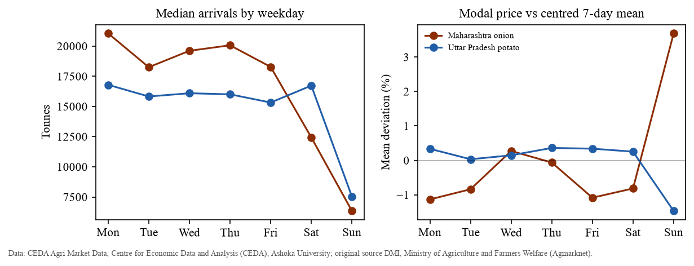

# CropCast: A Data-Driven Framework for Agricultural Commodity Price Forecasting and Market-Relative Anomaly Detection

**Course:** Data Science Ecosystem (DSE), 23CS2024 · **Problem reference:** SIH1647 · **Repository:** github.com/aswinsamuel-codes/cropcast-intelligence · **Date:** October 2026

## Abstract

<!-- ABSTRACT -->

**Keywords:** agricultural prices; onion; potato; time-series forecasting; walk-forward evaluation; Diebold–Mariano test; anomaly screening; Agmarknet; reproducibility

## 1. Introduction

Onion and potato are staple vegetables in India, and their wholesale prices are notoriously volatile. Sharp swings hurt consumers and producers alike, and they recur often enough to motivate both forecasting and early detection of unusual movements (Madaan et al., 2019; Paul et al., 2016). Daily wholesale ("mandi") prices and arrival volumes are published through Agmarknet by the Directorate of Marketing & Inspection. CEDA (Centre for Economic Data and Analysis, Ashoka University) redistributes them through an API with state-level daily aggregates.

This project asks what the available public data can support. Specifically:
1. How do state-level daily onion and potato prices behave, in trend, seasonality, missingness and their relationship with arrivals?
2. Can standard statistical and machine-learning models forecast the next market day's modal price better than simple baselines, under a leakage-free chronological evaluation?
3. Can unusual price movements be screened for in a defensible, reproducible way, and how should such detections be interpreted without verified ground truth?

**Contributions.** Stated modestly, the project contributes:
- a reproducible, checksum-verified pipeline from the CEDA API to a frozen analysis dataset, for Maharashtra onion and Uttar Pradesh potato (2016–2022);
- an exploratory analysis that identifies a weekday composition effect, a source-side reporting regime and partial-reporting days in the state aggregates;
- a pre-registered forecasting protocol, with seven models compared against naive baselines using Diebold–Mariano tests and false-discovery-rate control;
- an exploratory anomaly-screening method that is causal, weekday-aware and evaluated separately against weak labels and synthetic shocks.

The study makes no claim of methodological novelty.

## 2. Related Work

Madaan et al. (2019) studied onion and potato prices in India. They combined mandi wholesale prices, arrivals and retail prices to forecast prices and to flag anomalous windows that might indicate hoarding; their rule-based anomaly windows are used here as weak reference labels. Paul et al. (2016) modelled monthly wholesale onion prices in Delhi markets and found ARIMA residuals that still showed autocorrelation and conditional heteroscedasticity, which motivated (E)GARCH models. Shankar et al. (2023) analysed the volatility of onion arrivals and prices and reported gains from decomposition-based hybrid models. These studies mostly use monthly or mandi-level data, so their accuracy figures cannot be compared with the daily state-level setting here.

On methodology, simple benchmarks (naïve, seasonal naïve, drift) are the standard against which any method should be judged (Hyndman & Athanasopoulos, 2021). Large competitions show that statistical methods are difficult to beat and that pure machine-learning methods often fail to do so (Makridakis et al., 2020). Forecasts should be evaluated on a rolling forecasting origin (Tashman, 2000; Bergmeir & Benítez, 2012). Scale-free errors such as MASE avoid the instability of percentage errors (Hyndman & Koehler, 2006), and differences in accuracy should be tested allowing for serial correlation (Diebold & Mariano, 1995; Harvey et al., 1997). For anomaly detection, the definition must suit the domain (Chandola et al., 2009), and the median and MAD give outlier rules that are not distorted by the outliers they seek (Leys et al., 2013; Rousseeuw & Croux, 1993).

## 3. Data

**Source and series.** Daily state-level minimum, maximum and modal prices (INR per quintal) and arrivals (tonnes) were obtained from the CEDA Agri Market Data API for two series approved after a feasibility study: Maharashtra onion and Uttar Pradesh potato, 1 January 2016 to 31 December 2022.

**Acquisition.**
- The data was extracted in 56 six-month chunks, with requests kept under CEDA's limit of 40 per hour.
- Each file's SHA-256 checksum is recorded in a manifest.
- An offline audit verifies every chunk, schema, duplicate key, numeric rule and price–arrival alignment. It passes with two warnings, discussed below.
- Overlapping pilot files are excluded.
- The frozen dataset (v1) has one row per observed market day. Values are lossless (all 20,320 values match the raw files), output is deterministic, and nothing is imputed. Flag columns mark data-quality concerns; no value is changed.

**Licensing.** CEDA permits non-commercial use with the credit "Centre for Economic Data and Analysis (CEDA), Ashoka University". Its terms do not clearly permit redistributing the data, so raw and processed data are not published; figures and aggregate statistics are.

**Coverage.** Potato is complete: 2,557 of 2,557 days. Onion has 2,523 observed days; the 34 missing days (1.3%) form 13 gaps of up to 10 days, 20 of them in 2020. Price and arrival dates match exactly in both series.

**Scope limitation.** Each commodity has a single state aggregate, so there are no peer markets. Requirements that depend on peer markets (peer correlations, peer features, peer-divergence anomaly signals) were formally recorded as not applicable, and "market-relative" is defined relative to the market's own history.

## 4. Exploratory Data Analysis

**Price behaviour.**
- Both price series are right-skewed, with heavy-tailed daily log returns (excess kurtosis 5.0 for onion and 8.4 for potato).
- Onion is much more volatile: the daily log-return SD is 0.078, against 0.023 for potato, and 16.7% of onion day-to-day moves exceed ±10%. Its largest spike reached ₹7,506 per quintal in December 2019 (Figure 1).
- Potato rose to ₹3,015 during 2020 before collapsing in December 2020.
- The decomposition model was chosen by how dispersion scales with the level (Spearman correlation between yearly means and SDs: 0.82 for onion, 0.89 for potato), so seasonality was treated as multiplicative. Potato's annual seasonality is the stronger (STL seasonal strength 0.42 vs 0.24).
- Log levels give conflicting stationarity results (ADF rejects a unit root; KPSS rejects stationarity), while log returns are stationary by both tests.

![Figure 1. Daily modal price with the reported [min, max] band, 2016–2022. Data: CEDA, Ashoka University; original source DMI/Agmarknet.](../figures/fig01_price_series.png)

**A weekday composition effect.**
- The dominant periodic structure is weekly, not annual. The autocorrelation of daily log returns is −0.32/−0.30 at lag 1 and +0.31/+0.38 at lag 7 (onion/potato), against a 95% band of about ±0.04.
- Weekday differences in returns are highly significant (Kruskal–Wallis, Benjamini–Hochberg-adjusted p < 10⁻⁵⁰).
- Sunday arrivals fall to about a third of weekday levels. On Sundays the onion state price averages 3.7% above its centred weekly mean (Figure 2).
- The largest onion daily moves are Sunday spike-and-revert pairs, for example +70% on 3 March 2019 followed by −44% the next day.
- *Hypothesis:* the state figure averages over whichever mandis report each day, so a smaller, different Sunday set changes the aggregate without any change in market prices. Mandi counts are not in the data, so this cannot be verified here.

**Price–arrival association.** Month-on-month changes in log price and log arrivals are negatively associated:
- potato, Spearman ρ = −0.60, 95% block-bootstrap CI [−0.74, −0.34];
- onion, ρ = −0.20 [−0.41, −0.05].

This fits supply-driven price movements, but it is an association and does not establish causation.

**ISS-002: a reporting regime.** In 137 potato records (5.4%) the modal price lies outside the reported [min, max] band. The modal price's position within the band has a median of 0.07 from the start of the data to April 2017, against 0.50 afterwards, and the shift is abrupt (Figure 3). This points to a change in source reporting or aggregation rather than in market behaviour. CEDA's methodology page could not be retrieved, so the cause remains unresolved. Potato min/max prices are therefore excluded from model features.

![Figure 3. Position of the modal price within the [min, max] band (30-day rolling median). Grey: period containing the potato modal < min records.](../figures/fig10_modal_position_iss002.png)

**ISS-003: partial-reporting days.** Ten onion days have arrivals below 1% of the median (2–150 t), mostly in March–April 2020, around the start of India's national COVID-19 lockdown. On 8 of these 10 days the modal price is a whole number, against 4.6% of all days (Fisher exact p = 6×10⁻¹⁰). That suggests only one or a few mandis reported. These are treated as coverage anomalies, not market events.

<!-- RESULTS_SECTIONS -->
